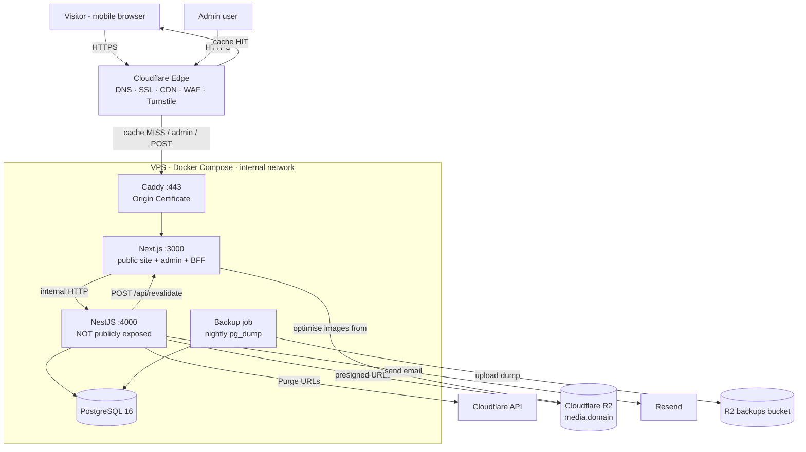

# Taj Band — System Architecture & Build Spec

> **Audience:** Claude Code (and any developer) setting up and building this project.
> **Rule:** Follow this document exactly. If something here is ambiguous or conflicts with reality (e.g. a library API has changed), stop and ask instead of guessing.

---

## 0. Project Summary

**Client:** TAJ BAND — heritage wedding brass band & baraat services company, Delhi-NCR. Tagline: _"Old Is Gold"_.

**Goal:** A fast, elegant, multi-page marketing website that:

1. Ranks for local searches (baraat band, wedding band, dhol, shehnai, vintage car/chattar, wedding lighting — Delhi, Noida, Gurugram, Ghaziabad, Faridabad).
2. Converts mobile visitors into **WhatsApp messages / phone calls** (primary) and inquiry form submissions (secondary).
3. Lets the client's non-technical staff edit **all** content through an admin panel — no code changes needed.

**Audience reality:** 80%+ mobile, arriving from Google Search, Google Maps, and Instagram, often on 4G.

---

## 1. Architectural Principles (non-negotiable)

| #   | Principle                              | What it means in practice                                                                                                                                                                       |
| --- | -------------------------------------- | ----------------------------------------------------------------------------------------------------------------------------------------------------------------------------------------------- |
| 1   | **Page views never hit the database.** | Public HTML is cached at two layers: the Cloudflare edge (HTML) and the Next.js Data Cache (API data). NestJS and Postgres only run for admin edits, inquiries, and cache misses.               |
| 2   | **The API is private.**                | NestJS is **not exposed to the internet**. Only Next.js talks to it, over the internal Docker network. The browser never calls NestJS directly (BFF pattern).                                   |
| 3   | **Mobile-first, minimal JS.**          | Server Components by default. `"use client"` only for interactive islands (menu, lightbox, carousel, form, gallery filters). The admin's JS must never ship to public pages.                    |
| 4   | **Content is data.**                   | Every piece of business content (services, packages, prices, reviews, FAQs, phone numbers, stats) comes from the database via the admin. Nothing business-specific is hard-coded in components. |
| 5   | **No invented facts.**                 | Seed data uses clearly marked `[PLACEHOLDER]` values for ratings, review counts, years, prices, phone numbers, celebrity names, and links.                                                      |
| 6   | **One server, boring infra.**          | A single VPS running Docker Compose behind Cloudflare. No Kubernetes, no microservices, no serverless.                                                                                          |

---

## 2. Tech Stack

| Layer                  | Technology                                                        | Notes                                                                                                                                 |
| ---------------------- | ----------------------------------------------------------------- | ------------------------------------------------------------------------------------------------------------------------------------- |
| Runtime                | **Node.js 22 LTS**                                                | Same version in dev, CI, and Docker images.                                                                                           |
| Package manager        | **pnpm** (workspaces)                                             | Lockfile committed.                                                                                                                   |
| Monorepo orchestration | **Turborepo**                                                     | `turbo prune` used for lean Docker builds.                                                                                            |
| Frontend               | **Next.js (latest stable, 15+), App Router, TypeScript (strict)** | `output: "standalone"`.                                                                                                               |
| Styling                | **Tailwind CSS v4**                                               | Design tokens via `@theme` in CSS.                                                                                                    |
| Fonts                  | **next/font**                                                     | Self-hosted, `display: swap`.                                                                                                         |
| Admin UI               | Custom components, **TanStack Query**, **Formik**, **Zustand**    | Admin route group only. See §18.                                                                                                      |
| Backend                | **NestJS 12, TypeScript (strict)**                                | REST, internal only. ESM (`nodenext`), Vitest.                                                                                        |
| ORM / DB               | **Prisma 7**, **MySQL 8 / MariaDB** (Hostinger MySQL)             | Migrations committed. Driver adapter `@prisma/adapter-mariadb`. Moved from PostgreSQL 16 on 2026-11-03 — see docs/HOSTINGER-MYSQL.md. |
| Validation             | **zod** (shared types), **class-validator** (Nest DTOs)           | Inquiry form: dependency-free validator (§18).                                                                                        |
| Auth                   | JWT (access token) + bcrypt                                       | Token lives in an httpOnly cookie set by Next.js.                                                                                     |
| Media storage          | **Cloudflare R2** (S3-compatible)                                 | Public bucket on `media.<domain>`; presigned uploads.                                                                                 |
| Image optimisation     | **next/image** + **sharp**                                        | Optimised images cached by Cloudflare.                                                                                                |
| Video                  | **YouTube** embeds with a click-to-load facade                    | No self-hosted video.                                                                                                                 |
| Email                  | **Resend**                                                        | Inquiry notifications to client.                                                                                                      |
| Spam protection        | **Cloudflare Turnstile** + honeypot + `@nestjs/throttler`         |                                                                                                                                       |
| Analytics              | **GA4** via `@next/third-parties`                                 | Event tracking for calls/WhatsApp/form.                                                                                               |
| Reverse proxy          | **Caddy 2**                                                       | TLS via Cloudflare Origin Certificate.                                                                                                |
| CDN / DNS / WAF        | **Cloudflare (Free plan)**                                        |                                                                                                                                       |
| Containers             | **Docker + Docker Compose**                                       |                                                                                                                                       |
| CI/CD                  | **GitHub Actions** → **GHCR** → SSH deploy                        | Images are built in CI, never on the VPS.                                                                                             |
| Hosting                | 1× VPS, 2 vCPU / 2–4 GB RAM, India region (Mumbai/Bangalore)      | Ubuntu 24.04 LTS.                                                                                                                     |

---

## 3. Infrastructure & Request Flow



### 3.1 Domains

| Host                                                  | Points to               | Cloudflare proxy     | Purpose                |
| ----------------------------------------------------- | ----------------------- | -------------------- | ---------------------- |
| `tajband.in` (placeholder — use real domain from env) | VPS IP                  | **Proxied (orange)** | Public site + `/admin` |
| `www.tajband.in`                                      | redirect → apex         | Proxied              | Redirect only          |
| `media.tajband.in`                                    | R2 bucket custom domain | Proxied              | Public media files     |

There is **no** `api.` subdomain. NestJS is reachable only as `http://api:4000` inside the Docker network.

### 3.2 Request types

| Request             | Path                                                                | Served by                                                                           |
| ------------------- | ------------------------------------------------------------------- | ----------------------------------------------------------------------------------- |
| Public page view    | `/`, `/services/*`, `/packages`, `/gallery`, `/reviews`, `/contact` | Cloudflare edge cache → (miss) Next.js → Next Data Cache → (miss) NestJS → Postgres |
| Static assets       | `/_next/static/*`, `/fonts/*`                                       | Cloudflare edge (immutable)                                                         |
| Optimised images    | `/_next/image?...`                                                  | Cloudflare edge → (miss) Next.js + sharp → R2                                       |
| Inquiry form submit | Server Action POST on `/contact` (and CTA forms)                    | Next.js → NestJS `POST /public/inquiries`                                           |
| Admin pages         | `/admin/*`                                                          | Next.js (never cached)                                                              |
| Admin data calls    | `/admin/bff/*`                                                      | Next.js route handler → NestJS (with bearer token from cookie)                      |
| Revalidation        | `POST http://web:3000/api/revalidate`                               | Called by NestJS over the internal network only                                     |

---

## 4. Caching & Rendering Strategy

### 4.1 Why not build-time SSG

Docker images are built in GitHub Actions, where the API and database are **not reachable**. Build-time prerendering would either fail or bake empty pages into the image. So:

- Public pages **render on the server on demand** (no build-time data fetching).
- Rendered output is cached in **two layers**, which gives the same speed as SSG with none of the build coupling.

### 4.2 Layer 1 — Next.js Data Cache (tagged)

All public data fetches go through `apps/web/src/lib/api/public.ts` and use:

```ts
fetch(`${API_INTERNAL_URL}/public/services/${slug}`, {
  cache: "force-cache",
  next: { tags: ["services", `service:${slug}`], revalidate: 86400 },
});
```

- Data stays cached until a tag is revalidated (or 24 h as a safety net).
- `.next/cache` is mounted as a **Docker volume** so it survives container restarts.

### 4.3 Layer 2 — Cloudflare edge HTML cache

Public routes are cached at the edge via **Cache Rules** (configured manually in the dashboard; see §12):

| Rule                 | Match                                            | Action                                                                               |
| -------------------- | ------------------------------------------------ | ------------------------------------------------------------------------------------ |
| 1. Bypass admin      | URI path starts with `/admin`                    | **Bypass cache**                                                                     |
| 2. Bypass internal   | URI path starts with `/api/`                     | **Bypass cache**                                                                     |
| 3. Cache public HTML | Hostname = apex AND not rules 1–2 AND method GET | **Eligible for cache**, Edge TTL **override: 1 day**, Browser TTL **respect origin** |

Requirements this places on the code:

- Public routes must **never set cookies** and never read cookies/headers in a way that varies output per user.
- Next.js `middleware` must be scoped to `/admin/:path*` only (matcher), so it never runs on public routes.
- Public responses should send `Cache-Control: public, max-age=0, must-revalidate` (browser always revalidates; edge holds the copy per the Cache Rule).

### 4.4 Content update flow (must work end-to-end)

```
Admin saves → Next BFF → NestJS writes to Postgres
           → NestJS POST http://web:3000/api/revalidate { tags: [...] }   (secret header)
           → Next calls revalidateTag() for each tag
           → NestJS calls Cloudflare Purge API with the affected URLs
           → next visitor gets fresh HTML within seconds
```

Ordering matters: **revalidate Next first, then purge Cloudflare.** Otherwise Cloudflare can re-cache stale HTML.

### 4.5 Entity → tags → URLs map

Implemented in NestJS `CacheInvalidationService`. Full URLs are built from `PUBLIC_SITE_URL`.

| Entity changed   | Next tags                                                | Cloudflare URLs to purge                                                                              |
| ---------------- | -------------------------------------------------------- | ----------------------------------------------------------------------------------------------------- |
| Service          | `services`, `service:<slug>` (old + new slug if renamed) | `/`, `/services/<slug>` (old + new), all other `/services/*` (related services block), `/sitemap.xml` |
| Package / Add-on | `packages`                                               | `/`, `/packages`, all `/services/*`                                                                   |
| Gallery item     | `gallery`                                                | `/`, `/gallery`, all `/services/*`                                                                    |
| Review           | `reviews`                                                | `/`, `/reviews`, all `/services/*`                                                                    |
| FAQ              | `faqs`, `service:<slug>` if linked                       | the linked service page, or all service pages if global                                               |
| Site settings    | `settings` + **all tags**                                | **Purge everything** (settings appear in header/footer/JSON-LD on every page)                         |
| Any deploy       | —                                                        | **Purge everything** (see §11.3)                                                                      |

Cloudflare free plan allows purge by URL (max 30 per call — batch if needed) and purge everything.

---

## 5. Repository Structure

```
taj-band/
├── apps/
│   ├── web/                         # Next.js — public site + admin + BFF
│   └── api/                         # NestJS — internal REST API
├── packages/
│   ├── types/                       # Shared TS types + zod schemas (DTO contracts)
│   ├── eslint-config/
│   └── tsconfig/
├── infra/
│   ├── caddy/Caddyfile
│   ├── docker-compose.dev.yml       # Postgres + RustFS (S3 stand-in for R2) (+ optional mailpit)
│   ├── docker-compose.prod.yml
│   ├── backup/                      # backup job Dockerfile + script
│   └── scripts/
│       ├── warmup.sh                # hits every sitemap URL after deploy/purge
│       └── server-bootstrap.md      # one-time VPS setup steps
├── .github/workflows/
│   ├── ci.yml                       # lint, typecheck, test on PRs
│   └── deploy.yml                   # build images, push GHCR, deploy
├── docs/
│   ├── ARCHITECTURE.md              # this file
│   └── CONTENT-EDITING-GUIDE.md     # for the client's staff
├── assets/taj-band-logo.png
├── turbo.json
├── pnpm-workspace.yaml
├── package.json
└── README.md
```

---

## 6. Frontend — `apps/web`

### 6.1 Directory layout

```
apps/web/src/
├── app/
│   ├── (site)/                      # PUBLIC — no auth, cacheable
│   │   ├── layout.tsx               # Header, Footer, StickyMobileBar, JSON-LD LocalBusiness
│   │   ├── page.tsx                 # Home
│   │   ├── services/[slug]/page.tsx
│   │   ├── packages/page.tsx
│   │   ├── gallery/page.tsx
│   │   ├── reviews/page.tsx
│   │   ├── contact/page.tsx
│   │   └── not-found.tsx
│   ├── (admin)/admin/               # ADMIN — protected, never cached
│   │   ├── login/page.tsx
│   │   ├── (protected)/
│   │   │   ├── layout.tsx           # sidebar shell, session check
│   │   │   ├── page.tsx             # dashboard
│   │   │   ├── services/...
│   │   │   ├── packages/...
│   │   │   ├── addons/...
│   │   │   ├── gallery/...
│   │   │   ├── reviews/...
│   │   │   ├── faqs/...
│   │   │   ├── inquiries/...
│   │   │   └── settings/page.tsx
│   │   └── bff/[...path]/route.ts   # BFF proxy → NestJS (GET/POST/PATCH/DELETE)
│   ├── api/
│   │   ├── revalidate/route.ts      # internal only — secret header required
│   │   └── auth/
│   │       ├── login/route.ts       # calls Nest /auth/login, sets httpOnly cookie
│   │       └── logout/route.ts
│   ├── sitemap.ts
│   ├── robots.ts
│   ├── layout.tsx                   # <html>, fonts, GA4
│   └── globals.css                  # Tailwind v4 + @theme tokens
├── components/
│   ├── site/                        # public components (server by default)
│   ├── admin/                       # admin-only components
│   └── ui/                          # shadcn/ui primitives (admin use only)
├── lib/
│   ├── api/public.ts                # import "server-only"; tagged fetchers
│   ├── api/internal.ts              # server-only fetch helper with base URL + errors
│   ├── seo/metadata.ts              # buildMetadata() helper
│   ├── seo/jsonld.ts                # LocalBusiness, Service, FAQPage, Breadcrumb builders
│   ├── whatsapp.ts                  # buildWhatsAppUrl(number, message)
│   ├── analytics.ts                 # trackEvent() wrappers
│   └── env.ts                       # zod-validated env
├── actions/
│   └── submit-inquiry.ts            # Server Action → Nest POST /public/inquiries
└── proxy.ts                         # Next 16 name for middleware; matcher: ["/admin/:path*"] only
```

> If the installed Next.js version renames `middleware.ts` (e.g. to `proxy.ts`), use the new convention with the same matcher.

### 6.2 Public pages

| Route              | Data                                                                  | Key sections                                                                                                                                                           |
| ------------------ | --------------------------------------------------------------------- | ---------------------------------------------------------------------------------------------------------------------------------------------------------------------- |
| `/`                | settings, services, packages (top 3), gallery (8), reviews (featured) | Hero (image, `priority`), TrustStrip, ServicesGrid, WhyTajBand, NetflixCallout, PackageTeaser, GalleryPreview, ReviewsCarousel, CTABand                                |
| `/services/[slug]` | service (with FAQs, media), related packages, other services          | H1, intro, inclusions, media block, area-served copy, related packages, FAQAccordion, related services, CTABand                                                        |
| `/packages`        | packages, add-ons                                                     | PackageCards ("Starting from ₹X" or "Price on request"), AddOns, comparison (table ≥ md, stacked cards < md), each CTA opens WhatsApp pre-filled with the package name |
| `/gallery`         | gallery items                                                         | Category tabs (URL `?category=` for shareability), masonry grid, lightbox (client), YouTube facade                                                                     |
| `/reviews`         | reviews, settings                                                     | Rating summary, ReviewCards, high-profile section, Netflix feature, video testimonials                                                                                 |
| `/contact`         | settings, services (for checkboxes)                                   | WhatsApp + Call buttons **above** the form, InquiryForm, map embed (lazy), hours, service areas                                                                        |

- `generateStaticParams` for `/services/[slug]` returns `[]` (no build-time fetch); `dynamicParams = true`.
- Unknown/unpublished slugs → `notFound()`.

### 6.3 Global components

| Component         | Type                       | Notes                                                                                                                                                 |
| ----------------- | -------------------------- | ----------------------------------------------------------------------------------------------------------------------------------------------------- |
| `Header`          | server + small client menu | Logo, nav (Services dropdown from DB), "Book on WhatsApp" button (≥ md).                                                                              |
| `MobileMenu`      | client                     | Accessible dialog, focus trap, ESC closes.                                                                                                            |
| `StickyMobileBar` | server                     | Fixed bottom on < md: **Call Now** (`tel:`) + **WhatsApp** (`wa.me` with page-aware message). Add bottom padding to `<main>` so content isn't hidden. |
| `TrustStrip`      | server                     | Google rating + count, "As seen on Netflix", years, weddings performed — **hide any item whose value is null**.                                       |
| `Footer`          | server                     | Logo, links, areas served, contact, socials. Map embed only on `/contact`.                                                                            |
| `CTABand`         | server                     | Reusable conversion block.                                                                                                                            |
| `SectionHeading`  | server                     | Eyebrow (gold small caps) + serif heading + optional gold divider.                                                                                    |
| `YouTubeFacade`   | client                     | Thumbnail + play button; loads iframe (`youtube-nocookie.com`) only on click.                                                                         |
| `Lightbox`        | client                     | Keyboard navigable, swipe on mobile, no heavy library.                                                                                                |
| `Carousel`        | client (tiny)              | CSS scroll-snap + buttons. **No Swiper/Embla**.                                                                                                       |
| `Reveal`          | client (tiny)              | IntersectionObserver fade/rise; respects `prefers-reduced-motion`.                                                                                    |

### 6.4 Design system

**Mood:** Royal Mughal-heritage elegance × modern editorial luxury. A high-end wedding magazine, not a flyer. Use the logo as-is; **do not** replicate its glossy gold or display typeface elsewhere.

```css
/* apps/web/src/app/globals.css */
@import "tailwindcss";

@theme {
  --color-cocoa-950: #1e0a05;
  --color-cocoa-900: #2b0f08;
  --color-cocoa-800: #3d1a10;
  --color-gold-500: #c9a24a; /* antique gold — borders, dividers, icons, eyebrows. Sparingly. */
  --color-gold-300: #e2c98a;
  --color-ivory-50: #f7f1e6; /* light section background */
  --color-ivory-100: #efe5d3;
  --color-saffron-500: #e8892b; /* primary CTA only */
  --color-saffron-600: #cf7419;
  --color-ink-900: #1a1410; /* body text on ivory */

  --font-serif: var(--font-cormorant), "Times New Roman", serif;
  --font-sans: var(--font-inter), system-ui, sans-serif;
}
```

- **Fonts:** Cormorant Garamond (headings, weights 500/600/700) + Inter (body, variable). Max 2 families.
- **Type scale:** fluid with `clamp()`. Body ≥ 16px on mobile.
- **Ornament:** jharokha (Mughal arch) image masks via CSS `clip-path`/`mask`, thin gold dividers, faint jaali SVG pattern at ≤ 6% opacity. Restraint.
- **Sections:** alternate cocoa (dark) and ivory (light) backgrounds for rhythm.
- **Contrast:** verify WCAG AA for gold-on-cocoa and ink-on-ivory. Gold text is for large/eyebrow text only, never body copy.
- **WhatsApp button:** saffron fill (brand), WhatsApp icon. Do not use WhatsApp green as a page-wide color.

### 6.5 Data fetching rules

- `lib/api/public.ts` starts with `import "server-only";` — public fetchers can never be bundled to the client.
- Every fetcher has typed return values from `@taj/types`, tags per §4.5, and throws on non-2xx (pages handle via `notFound()` or error boundary).
- `API_INTERNAL_URL` = `http://api:4000` in Docker, `http://localhost:4000` in dev.
- No client-side fetching for public page content.

### 6.6 Inquiry form

- Fields: name, phone (Indian mobile validation), wedding date, venue/area, services (checkboxes from DB), message, hidden `sourcePage`, hidden honeypot `company`.
- Cloudflare Turnstile widget (client); token sent with the submission.
- Submitted via a **Server Action** (`actions/submit-inquiry.ts`) → zod validate → `POST http://api:4000/public/inquiries` with the Turnstile token and `CF-Connecting-IP` forwarded.
- Success state: thank-you message + "Prefer WhatsApp? Message us now" button.
- Fire `generate_lead` GA4 event on success.

### 6.7 Admin panel

- **Auth:** `/admin/login` posts to `/api/auth/login` (Next route handler) → calls Nest `POST /auth/login` → receives JWT → sets cookie `tb_session` (httpOnly, Secure, SameSite=Strict, Path=/, 8 h).
- **Middleware** (matcher `/admin/:path*`, excluding `/admin/login`): if no `tb_session` → redirect to login. (Signature is verified by Nest on every BFF call; middleware only checks presence/expiry.)
- **BFF:** `/admin/bff/[...path]` forwards method, body, and query to `http://api:4000/admin/<path>` with `Authorization: Bearer <cookie value>`. On 401 → clear cookie, return 401 → client redirects to login. Validate that `path` cannot escape the `/admin` prefix.
- **Screens:** dashboard (new inquiries count, recent inquiries, quick links), CRUD tables + forms for every entity, drag-to-reorder (services, packages, gallery, reviews), image upload with preview + **required alt text**, settings form, inquiries list with status filter + notes.
- **Uploads:** client asks BFF for a presigned URL → `PUT` directly to R2 → saves returned media record. Client-side resize to max 2400px long edge before upload.
- **UX:** built for non-technical staff — plain labels, helper text, confirm dialogs on delete, toast on save, "View on site" link per item.
- Admin code (shadcn, TanStack Query, react-hook-form) is imported **only** inside `(admin)` — verify with the bundle analyzer that none of it appears in public route chunks.

### 6.8 SEO implementation

- `buildMetadata()` helper: title template `%s | Taj Band — Wedding Band & Baraat, Delhi`, description, canonical (`alternates.canonical`), Open Graph, Twitter card. All values from the DB (with sensible fallbacks).
- **JSON-LD** (rendered in a `<script type="application/ld+json">` from server components):
  - `EntertainmentBusiness` (LocalBusiness subtype) in the site layout: name, logo, image, url, telephone, address, geo, openingHoursSpecification, areaServed (cities), sameAs (socials).
  - `Service` on each service page (provider → the business, areaServed).
  - `FAQPage` on pages with FAQs.
  - `BreadcrumbList` on all inner pages.
  - **Do not** add `AggregateRating`/`Review` markup for the business's own reviews (self-serving review markup is ignored or penalised for LocalBusiness).
- `sitemap.ts`: home, static pages, all published service slugs, with `lastModified` from DB `updatedAt`. Uses the tagged fetchers.
- `robots.ts`: allow all; disallow `/admin` and `/api`; reference sitemap.
- One `<h1>` per page; logical H2/H3. All images require alt text (enforced in admin).
- Area-served copy blocks on service pages (Delhi, Noida, Gurugram, Ghaziabad, Faridabad). **No** thin duplicate per-city pages.
- `www` → apex 301 redirect (Cloudflare redirect rule or Caddy).

### 6.9 Performance rules & budgets

| Metric (mobile, 4G, Lighthouse)                    | Target                       |
| -------------------------------------------------- | ---------------------------- |
| Performance / SEO / Accessibility / Best Practices | **≥ 95 / 100 / ≥ 95 / ≥ 95** |
| LCP                                                | < 2.0 s                      |
| CLS                                                | < 0.05                       |
| INP                                                | < 200 ms                     |
| First-load JS on public routes                     | < 120 KB gzip                |

- Hero image: `priority`, `fetchPriority="high"`, correct `sizes`, AVIF/WebP. No autoplay video on mobile (poster image only; muted autoplay allowed ≥ md if the client insists).
- Every `next/image` has an accurate `sizes` prop.
- `next.config`: `images.formats = ["image/avif", "image/webp"]`, `images.remotePatterns` for `media.<domain>`, `images.minimumCacheTTL = 31536000` (R2 keys are content-hashed and immutable).
- No animation libraries, no carousel libraries, no icon packs imported wholesale (use `lucide-react` per-icon imports or inline SVG).
- Third-party scripts: GA4 and Turnstile only. Turnstile loads only on pages with a form.
- Map embed: Google Maps iframe on `/contact` with `loading="lazy"` (loads only near the viewport), plus Get directions / Open in Google Maps links. Link set in admin → Site settings.

### 6.10 Analytics events (GA4)

| Event            | Trigger              | Params                                        |
| ---------------- | -------------------- | --------------------------------------------- |
| `click_call`     | any `tel:` link      | `location` (header/sticky/cta/footer), `page` |
| `click_whatsapp` | any `wa.me` link     | `location`, `page`, `package` (if any)        |
| `generate_lead`  | inquiry form success | `services`, `page`                            |

### 6.11 Accessibility

WCAG 2.1 AA: tap targets ≥ 44 px, visible focus states (gold ring), skip-to-content link, keyboard-operable menu/lightbox/accordion/tabs, `aria-live` for form status, `prefers-reduced-motion` respected, `lang="en-IN"`.

---

## 7. Backend — `apps/api`

### 7.1 Directory layout

```
apps/api/src/
├── main.ts                     # bootstrap: helmet, validation pipe, swagger (non-prod or behind flag), shutdown hooks
├── app.module.ts
├── config/                     # @nestjs/config + zod env schema (fail fast on boot)
├── prisma/                     # PrismaModule, PrismaService
├── common/
│   ├── guards/jwt-auth.guard.ts
│   ├── guards/internal-only.guard.ts
│   ├── filters/http-exception.filter.ts
│   ├── interceptors/
│   └── dto/pagination.dto.ts
├── modules/
│   ├── auth/
│   ├── services/
│   ├── packages/               # packages + add-ons
│   ├── gallery/
│   ├── reviews/
│   ├── faqs/
│   ├── settings/
│   ├── inquiries/
│   ├── media/                  # R2 presign + media records
│   ├── cache-invalidation/     # Next revalidate + Cloudflare purge
│   ├── notifications/          # Resend email
│   └── health/
└── prisma/
    ├── schema.prisma
    ├── migrations/
    └── seed.ts
```

### 7.2 Prisma schema

```prisma
// Prisma 7: the connection URL lives in prisma.config.ts (datasource.url),
// and PrismaClient connects through the @prisma/adapter-pg driver adapter.
generator client {
  provider            = "prisma-client"
  output              = "../src/generated/prisma"
  moduleFormat        = "esm"
  importFileExtension = "js"
}

datasource db {
  provider = "postgresql"
}

model AdminUser {
  id           String   @id @default(cuid())
  email        String   @unique
  passwordHash String
  name         String
  lastLoginAt  DateTime?
  createdAt    DateTime @default(now())
  updatedAt    DateTime @updatedAt
}

model Media {
  id        String   @id @default(cuid())
  key       String   @unique          // R2 object key (content-hashed)
  url       String                    // public URL on media.<domain>
  mimeType  String
  width     Int?
  height    Int?
  alt       String                    // required
  createdAt DateTime @default(now())

  serviceHeroes  Service[]     @relation("ServiceHero")
  galleryItems   GalleryItem[]
}

model Service {
  id               String    @id @default(cuid())
  slug             String    @unique
  title            String                     // nav/card title, e.g. "Brass Band & Baraat"
  h1               String                     // SEO H1
  shortDescription String                     // card text
  intro            String                     // opening paragraph
  sections         Json      @default("[]")   // [{ heading: string, body: string }]
  inclusions       String[]
  areaCopy         String?                    // area-served paragraph
  heroImageId      String?
  heroImage        Media?    @relation("ServiceHero", fields: [heroImageId], references: [id], onDelete: SetNull)
  seoTitle         String?
  seoDescription   String?
  order            Int       @default(0)
  published        Boolean   @default(false)
  faqs             Faq[]
  relatedPackages  Package[] @relation("ServicePackages")
  createdAt        DateTime  @default(now())
  updatedAt        DateTime  @updatedAt
}

model Package {
  id            String    @id @default(cuid())
  slug          String    @unique
  name          String                     // Classic / Royal / Maharaja
  tagline       String?
  startingPrice Int?                       // INR; null → "Price on request"
  priceNote     String?                    // e.g. "per baraat, Delhi-NCR"
  inclusions    String[]
  highlighted   Boolean   @default(false)
  order         Int       @default(0)
  published     Boolean   @default(false)
  services      Service[] @relation("ServicePackages")
  createdAt     DateTime  @default(now())
  updatedAt     DateTime  @updatedAt
}

model AddOn {
  id            String   @id @default(cuid())
  name          String
  description   String?
  startingPrice Int?
  order         Int      @default(0)
  published     Boolean  @default(true)
  createdAt     DateTime @default(now())
  updatedAt     DateTime @updatedAt
}

enum GalleryType {
  IMAGE
  VIDEO
}

enum GalleryCategory {
  BARAAT
  BAND
  DHOL
  CARS_CHATTAR
  LIGHTING
  VIDEO
}

model GalleryItem {
  id        String          @id @default(cuid())
  type      GalleryType
  category  GalleryCategory
  mediaId   String?                       // required when IMAGE; poster when VIDEO
  media     Media?          @relation(fields: [mediaId], references: [id], onDelete: SetNull)
  youtubeId String?                       // required when VIDEO
  caption   String?
  order     Int             @default(0)
  published Boolean         @default(true)
  createdAt DateTime        @default(now())
  updatedAt DateTime        @updatedAt
}

enum ReviewSource {
  GOOGLE
  DIRECT
  HIGH_PROFILE
}

model Review {
  id        String       @id @default(cuid())
  author    String
  rating    Int                          // 1–5 (validate)
  text      String
  source    ReviewSource
  eventDate DateTime?
  featured  Boolean      @default(false)
  order     Int          @default(0)
  published Boolean      @default(true)
  createdAt DateTime     @default(now())
  updatedAt DateTime     @updatedAt
}

model Faq {
  id        String   @id @default(cuid())
  question  String
  answer    String
  serviceId String?                       // null = global FAQ
  service   Service? @relation(fields: [serviceId], references: [id], onDelete: Cascade)
  order     Int      @default(0)
  published Boolean  @default(true)
  createdAt DateTime @default(now())
  updatedAt DateTime @updatedAt
}

enum InquiryStatus {
  NEW
  CONTACTED
  BOOKED
  LOST
  SPAM
}

model Inquiry {
  id          String        @id @default(cuid())
  name        String
  phone       String
  weddingDate DateTime?
  venue       String?
  services    String[]                    // service slugs
  message     String?
  sourcePage  String?
  ip          String?
  status      InquiryStatus @default(NEW)
  notes       String?
  createdAt   DateTime      @default(now())
  updatedAt   DateTime      @updatedAt

  @@index([status, createdAt])
}

model SiteSettings {
  id                Int      @id @default(1)   // singleton
  businessName      String   @default("Taj Band")
  tagline           String   @default("Old Is Gold")
  phone             String
  whatsapp          String                      // E.164 without "+", e.g. 91XXXXXXXXXX
  email             String?
  addressLine       String
  city              String
  postalCode        String?
  geoLat            Float?
  geoLng            Float?
  hours             Json     @default("[]")     // [{ days: string[], opens: "09:00", closes: "21:00" }]
  mapEmbedUrl       String?
  googleRating      Float?
  googleReviewCount Int?
  googleProfileUrl  String?
  foundedYear       Int?
  weddingsPerformed Int?
  netflixUrl        String?
  socials           Json     @default("{}")     // { instagram, facebook, youtube }
  serviceAreas      String[] @default(["Delhi", "Noida", "Gurugram", "Ghaziabad", "Faridabad"])
  whatsappDefaultMessage String @default("Hi Taj Band, I'd like to check availability for my wedding.")
  updatedAt         DateTime @updatedAt
}
```

### 7.3 API endpoints

All routes are internal (`http://api:4000`). Global prefix: none. Swagger at `/docs` (enabled only when `SWAGGER_ENABLED=true`; access in prod via SSH tunnel).

**Public (read) — guarded by `InternalOnlyGuard` (requires `X-Internal-Token` header = `INTERNAL_API_TOKEN`)**

| Method | Path                        | Returns                                                       |
| ------ | --------------------------- | ------------------------------------------------------------- |
| GET    | `/public/settings`          | SiteSettings                                                  |
| GET    | `/public/services`          | published services (card fields) ordered                      |
| GET    | `/public/services/:slug`    | full service + FAQs + hero + related packages                 |
| GET    | `/public/packages`          | published packages                                            |
| GET    | `/public/addons`            | published add-ons                                             |
| GET    | `/public/gallery?category=` | published gallery items                                       |
| GET    | `/public/reviews?featured=` | published reviews                                             |
| GET    | `/public/faqs?global=true`  | global FAQs                                                   |
| GET    | `/public/sitemap`           | `{ slug, updatedAt }[]` for services + static page timestamps |
| POST   | `/public/inquiries`         | creates inquiry (Turnstile verified, throttled)               |

**Auth**

| Method | Path          | Notes                                                                         |
| ------ | ------------- | ----------------------------------------------------------------------------- |
| POST   | `/auth/login` | `{ email, password }` → `{ accessToken, expiresAt }`. Throttle: 5/min per IP. |
| GET    | `/auth/me`    | current admin                                                                 |

**Admin — guarded by `JwtAuthGuard`**

Standard REST per entity: `GET /admin/<entity>`, `GET /admin/<entity>/:id`, `POST /admin/<entity>`, `PATCH /admin/<entity>/:id`, `DELETE /admin/<entity>/:id`, `PATCH /admin/<entity>/reorder` (body: `{ ids: string[] }`).

Entities: `services`, `packages`, `addons`, `gallery`, `reviews`, `faqs`, `inquiries` (no POST; PATCH status/notes only), `settings` (`GET`/`PATCH` singleton only).

Media: `POST /admin/media/presign` (`{ filename, mimeType, size }` → `{ uploadUrl, key, publicUrl }`), `POST /admin/media` (create record after upload with width/height/alt), `DELETE /admin/media/:id` (also deletes R2 object; refuse if in use).

Dashboard: `GET /admin/stats` (inquiry counts by status, last 7/30 days).

**Ops**

| Method | Path      | Notes                               |
| ------ | --------- | ----------------------------------- |
| GET    | `/health` | DB ping; used by Docker healthcheck |

Every successful admin write calls `CacheInvalidationService.invalidate(entity, before, after)` **after** the DB transaction commits. Invalidation failures are logged and retried (3× with backoff) but never fail the admin request.

### 7.4 Module responsibilities

- **auth:** bcrypt (cost 12) verify, JWT sign (`JWT_SECRET`, 8 h), `lastLoginAt` update. Seed creates the first admin from `SEED_ADMIN_EMAIL` / `SEED_ADMIN_PASSWORD`.
- **inquiries:** verify Turnstile token via Cloudflare siteverify API; reject if honeypot filled (respond 200 to bots, store as SPAM); throttle 5 requests / 10 min per IP; store; send email via `notifications`.
- **notifications:** Resend email to `INQUIRY_NOTIFY_EMAILS` with all fields + a pre-built `wa.me` reply link to the customer's number. Failure is logged, never blocks inquiry creation.
- **media:** `@aws-sdk/client-s3` + `@aws-sdk/s3-request-presigner` against R2 endpoint. Keys: `uploads/<yyyy>/<mm>/<sha8>-<slugified-name>.<ext>`. Allowed types: jpeg, png, webp, avif. Max 15 MB.
- **cache-invalidation:** implements §4.5. Calls `POST ${WEB_INTERNAL_URL}/api/revalidate` with header `X-Revalidate-Secret`, then Cloudflare `POST /zones/:zone_id/purge_cache` (batched ≤ 30 URLs, or `purge_everything` for settings).
- **settings:** singleton upsert (id = 1).

### 7.5 Cross-cutting

- `ValidationPipe({ whitelist: true, forbidNonWhitelisted: true, transform: true })`.
- `helmet()`; CORS **disabled** (no browser calls the API).
- Consistent error shape: `{ statusCode, message, error }`.
- Structured logging (pino via `nestjs-pino`), JSON in prod.
- Graceful shutdown (`enableShutdownHooks`).
- Unit tests for services with business logic (invalidation map, inquiries, auth); e2e test for login + one CRUD flow + inquiry submission.

---

## 8. Shared Package — `packages/types`

- zod schemas + inferred TS types for every public response and admin DTO (`ServiceCard`, `ServiceDetail`, `Package`, `GalleryItem`, `Review`, `SiteSettings`, `InquiryInput`, …).
- Used by Next (form validation, fetcher return types) and mirrored by Nest DTOs.
- No runtime dependencies beyond `zod`.

---

## 9. Environment Variables

Each app validates its env with zod at startup and **refuses to boot** if invalid. Provide `.env.example` files.

### `apps/web`

| Var                              | Example              | Purpose                                      |
| -------------------------------- | -------------------- | -------------------------------------------- |
| `NEXT_PUBLIC_SITE_URL`           | `https://tajband.in` | canonical URLs, sitemap                      |
| `API_INTERNAL_URL`               | `http://api:4000`    | server-only base URL                         |
| `INTERNAL_API_TOKEN`             | random 32+ chars     | sent as `X-Internal-Token` on public fetches |
| `REVALIDATE_SECRET`              | random 32+ chars     | checks `X-Revalidate-Secret`                 |
| `NEXT_PUBLIC_MEDIA_HOST`         | `media.tajband.in`   | `next/image` remotePatterns                  |
| `NEXT_PUBLIC_GA_ID`              | `G-XXXXXXX`          | GA4                                          |
| `NEXT_PUBLIC_TURNSTILE_SITE_KEY` | `0x...`              | Turnstile widget                             |
| `SESSION_COOKIE_NAME`            | `tb_session`         |                                              |

### `apps/api`

| Var                                                                                            | Example                                | Purpose            |
| ---------------------------------------------------------------------------------------------- | -------------------------------------- | ------------------ |
| `DATABASE_URL`                                                                                 | `postgresql://taj:***@db:5432/tajband` | Prisma             |
| `PORT`                                                                                         | `4000`                                 |                    |
| `JWT_SECRET`                                                                                   | random 64 chars                        |                    |
| `INTERNAL_API_TOKEN`                                                                           | same as web                            | guard              |
| `WEB_INTERNAL_URL`                                                                             | `http://web:3000`                      | revalidation calls |
| `REVALIDATE_SECRET`                                                                            | same as web                            |                    |
| `PUBLIC_SITE_URL`                                                                              | `https://tajband.in`                   | build purge URLs   |
| `CLOUDFLARE_ZONE_ID`                                                                           |                                        | purge              |
| `CLOUDFLARE_API_TOKEN`                                                                         | scoped: Zone → Cache Purge             | purge              |
| `TURNSTILE_SECRET_KEY`                                                                         |                                        | siteverify         |
| `R2_ACCOUNT_ID`, `R2_ACCESS_KEY_ID`, `R2_SECRET_ACCESS_KEY`, `R2_BUCKET`, `R2_PUBLIC_BASE_URL` |                                        | media              |
| `RESEND_API_KEY`, `MAIL_FROM`, `INQUIRY_NOTIFY_EMAILS`                                         |                                        | notifications      |
| `SEED_ADMIN_EMAIL`, `SEED_ADMIN_PASSWORD`                                                      |                                        | seed only          |
| `SWAGGER_ENABLED`                                                                              | `false` in prod                        |                    |

### `infra` (prod `.env` on the server, never committed)

`POSTGRES_USER`, `POSTGRES_PASSWORD`, `POSTGRES_DB`, `BACKUP_R2_BUCKET`, `BACKUP_RETENTION_DAYS=14`, `GHCR_OWNER`, `IMAGE_TAG`.

---

## 10. Docker & Infrastructure Files

### 10.1 Images

- **web:** multi-stage — `turbo prune web --docker` → install → `next build` → runner stage copies `.next/standalone`, `.next/static`, `public`. Runs as non-root `node`. Includes `sharp`.
- **api:** multi-stage — `turbo prune api --docker` → install → `prisma generate` → `nest build` → runner with prod deps only. Entrypoint: `prisma migrate deploy && node dist/main.js`. Non-root.
- Both: `HEALTHCHECK`, `NODE_ENV=production`, `TZ=Asia/Kolkata`.

### 10.2 `infra/docker-compose.prod.yml` (shape)

```yaml
services:
  caddy:
    image: caddy:2-alpine
    ports: ["80:80", "443:443"]
    volumes:
      - ./caddy/Caddyfile:/etc/caddy/Caddyfile:ro
      - ./certs:/certs:ro # Cloudflare Origin Certificate
      - caddy_data:/data
    depends_on: [web]
    restart: unless-stopped

  web:
    image: ghcr.io/${GHCR_OWNER}/taj-web:${IMAGE_TAG}
    env_file: ./env/web.env
    volumes:
      - next_cache:/app/apps/web/.next/cache
    depends_on:
      api: { condition: service_healthy }
    restart: unless-stopped
    # no published ports

  api:
    image: ghcr.io/${GHCR_OWNER}/taj-api:${IMAGE_TAG}
    env_file: ./env/api.env
    depends_on:
      db: { condition: service_healthy }
    restart: unless-stopped
    # no published ports

  db:
    image: postgres:16-alpine
    environment:
      POSTGRES_USER: ${POSTGRES_USER}
      POSTGRES_PASSWORD: ${POSTGRES_PASSWORD}
      POSTGRES_DB: ${POSTGRES_DB}
    volumes: [pg_data:/var/lib/postgresql/data]
    healthcheck: { test: ["CMD-SHELL", "pg_isready -U ${POSTGRES_USER}"], interval: 10s }
    restart: unless-stopped
    # no published ports

  backup:
    build: ./backup # postgres:16-alpine + rclone + crond
    env_file: ./env/backup.env
    depends_on: [db]
    restart: unless-stopped

volumes:
  caddy_data:
  next_cache:
  pg_data:
```

Only Caddy publishes ports. Memory limits: web 768 MB, api 384 MB, db 512 MB (adjust to VPS size).

### 10.3 `infra/caddy/Caddyfile`

```caddy
{
	servers {
		# Keep in sync with https://www.cloudflare.com/ips/
		trusted_proxies static 173.245.48.0/20 103.21.244.0/22 103.22.200.0/22 103.31.4.0/22 141.101.64.0/18 108.162.192.0/18 190.93.240.0/20 188.114.96.0/20 197.234.240.0/22 198.41.128.0/17 162.158.0.0/15 104.16.0.0/13 104.24.0.0/14 172.64.0.0/13 131.0.72.0/22
		client_ip_headers CF-Connecting-IP
	}
}

www.{$SITE_DOMAIN} {
	tls /certs/origin.pem /certs/origin-key.pem
	redir https://{$SITE_DOMAIN}{uri} permanent
}

{$SITE_DOMAIN} {
	tls /certs/origin.pem /certs/origin-key.pem
	encode zstd gzip

	# Internal endpoint must never be reachable from outside
	@revalidate path /api/revalidate
	respond @revalidate 404

	reverse_proxy web:3000
}
```

### 10.4 Backups

- `infra/backup`: nightly at 02:30 IST → `pg_dump -Fc` → upload to R2 backups bucket via rclone → delete objects older than `BACKUP_RETENTION_DAYS`.
- Document a tested restore procedure in `README.md`.

### 10.5 `infra/docker-compose.dev.yml`

Postgres 16 on `localhost:5432` and RustFS (S3-compatible stand-in for R2) on `localhost:9000` (+ optional Mailpit). The API creates the public `taj-media` bucket + CORS on startup in development. Apps run natively with `pnpm dev` (Turborepo runs web on 3000 and api on 4000 in parallel).

---

## 11. CI/CD

### 11.1 `ci.yml` (pull requests)

`pnpm install --frozen-lockfile` → `turbo lint typecheck test` → `next build` (smoke check, no API needed).

### 11.2 `deploy.yml` (push to `main`)

1. Lint, typecheck, test.
2. Build `taj-web` and `taj-api` images with Docker Buildx (layer cache via GHA cache), tag with commit SHA + `latest`, push to GHCR.
3. SSH to VPS (key in GitHub secrets): `cd /opt/taj-band && IMAGE_TAG=<sha> docker compose -f docker-compose.prod.yml pull && ... up -d`.
4. Wait for `api` and `web` healthchecks.
5. **Purge everything** in Cloudflare.
6. Run `infra/scripts/warmup.sh` (fetches every URL in `sitemap.xml` to prime caches).

### 11.3 Why purge on every deploy

Cached HTML at the edge references hashed JS/CSS chunks from the **previous** build. The new container no longer serves those chunks, so stale HTML would break pages. Purging on deploy prevents version skew.

### 11.4 Rollback

Redeploy the previous image tag: `IMAGE_TAG=<previous-sha> docker compose up -d`, then purge. Migrations must be backward-compatible (additive) to allow this.

---

## 12. Manual Setup Checklist (done by a human, not Claude Code)

**Cloudflare (account owned by the client, developer added as admin)**

- [ ] Add domain; switch nameservers.
- [ ] DNS: `A @ → VPS IP` (proxied), `CNAME www → @` (proxied).
- [ ] SSL/TLS mode: **Full (strict)**. Always Use HTTPS: on. Min TLS 1.2.
- [ ] Create **Origin Certificate** (RSA, 15 years) → save to `/opt/taj-band/certs/origin.pem` + `origin-key.pem` (chmod 600).
- [ ] Cache Rules per §4.3.
- [ ] Rate limiting rule: POST on `/contact*` > 10/min per IP → block 10 min.
- [ ] Turnstile site → site key + secret.
- [ ] API token: Zone → Cache Purge (this zone only).
- [ ] R2: buckets `taj-media` (public via custom domain `media.<domain>`) and `taj-backups` (private); R2 API token; CORS on `taj-media` allowing `PUT` from `https://<domain>`.

**VPS (Ubuntu 24.04)**

- [ ] Non-root sudo user, SSH key auth only, password auth disabled.
- [ ] UFW: allow 22 (ideally from your IP), allow 80/443 **only from Cloudflare IP ranges**, deny the rest.
- [ ] Docker Engine + Compose plugin; log rotation configured.
- [ ] `unattended-upgrades` enabled.
- [ ] `/opt/taj-band` with compose file, Caddyfile, `certs/`, `env/`.
- [ ] GHCR read token for pulling images.

**Other**

- [ ] Resend: verify sending domain (SPF/DKIM records in Cloudflare DNS).
- [ ] GA4 property; Google Search Console (DNS verification) → submit sitemap.
- [ ] Google Business Profile: website link → homepage, service links where possible.

---

## 13. Security Checklist

- [ ] API has no published ports; `InternalOnlyGuard` on public routes; `JwtAuthGuard` on admin routes.
- [ ] `/api/revalidate` blocked at Caddy and secret-checked in code.
- [ ] Session cookie: httpOnly, Secure, SameSite=Strict.
- [ ] BFF prevents path traversal outside `/admin/*`.
- [ ] Login throttled; generic error messages.
- [ ] Secrets only in server `.env` files and GitHub secrets — never committed.
- [ ] Upload validation (type, size) server-side; presigned URLs expire in 5 min.
- [ ] Postgres not exposed; strong password; nightly backups verified.
- [ ] Dependency audit in CI (`pnpm audit --prod`, non-blocking warning).

---

## 14. Coding Conventions

- TypeScript `strict: true` everywhere; no `any` without a comment explaining why.
- ESLint + Prettier shared config; import order enforced.
- Components: PascalCase files; one component per file; colocate small helpers.
- Server Components by default; any `"use client"` file must be small and justified.
- No business content hard-coded in components — read from DB/settings.
- Conventional Commits (`feat:`, `fix:`, `chore:` …).
- Every module/page added → update `README.md` if it changes setup or behaviour.

---

## 15. Seed Data

`pnpm --filter api prisma db seed` creates:

- 1 admin user (from env).
- `SiteSettings` with `[PLACEHOLDER]` phone/WhatsApp/address and **null** rating, review count, founded year, weddings performed, Netflix URL (so the TrustStrip hides them until real values are entered).
- 5 services (published): `brass-band-baraat`, `dhol-players`, `shehnai-live-music`, `vintage-cars-chattar`, `wedding-lighting` — realistic placeholder copy, 6 FAQs each.
- 3 packages: Classic, Royal (highlighted), Maharaja — `startingPrice: null` ("Price on request") until the client confirms.
- 4 add-ons: extra dhol, ghodi/horse, lighting upgrade, vintage car.
- 8 reviews marked `[PLACEHOLDER]` in the author name.
- Gallery: 12 placeholder items using local sample images uploaded to R2 by a seed script flag (or skipped if R2 env is absent).

---

## 16. Build Phases & Acceptance Criteria

Work through phases **in order**. At the end of each phase: stop, summarise what was built, list files changed, and list anything the human must provide.

### Phase 1 — Monorepo & foundations

- pnpm + Turborepo workspace, shared tsconfig/eslint, `packages/types`.
- `apps/web` with Tailwind v4 tokens, fonts, root + site layouts, Header, Footer, StickyMobileBar (static placeholder data for now).
- `apps/api` Nest skeleton with config validation, Prisma, `/health`.
- `docker-compose.dev.yml`.
- ✅ `pnpm dev` runs both apps; web renders the layout on mobile and desktop; `/health` returns OK.

### Phase 2 — Deployment pipeline (before features)

- Dockerfiles, `docker-compose.prod.yml`, Caddyfile, backup job, GitHub Actions workflows, `warmup.sh`, `server-bootstrap.md`.
- One tagged public fetch + `/api/revalidate` + Nest `CacheInvalidationService` wired to a test entity.
- ✅ Deployed to the VPS behind Cloudflare; changing the test record makes the live page update within ~10 s; Lighthouse runs against the real domain.

### Phase 3 — Backend complete

- Full Prisma schema + migrations, all modules and endpoints (§7.3), auth, media presign, inquiries (Turnstile, throttling, email), seed script, Swagger, tests.
- ✅ All endpoints documented in Swagger; e2e tests pass; seed produces a fully browsable dataset.

### Phase 4 — Public site

- All public pages and components (§6.2–6.3), tagged fetchers, inquiry Server Action, WhatsApp/Call links with page-aware messages, GA4 events.
- ✅ Every page renders from DB data; unpublished items are hidden; form submission creates an inquiry and sends an email.

### Phase 5 — Admin panel

- Login/logout, middleware, BFF, all CRUD screens, reorder, uploads with alt text, inquiries management, settings, dashboard.
- ✅ A non-technical user can edit every piece of public content; each edit appears on the live site within ~10 s; admin JS absent from public bundles.

### Phase 6 — SEO, performance & accessibility pass

- Metadata, JSON-LD, sitemap, robots, redirects; performance tuning to hit §6.9 budgets; a11y audit and fixes.
- ✅ Lighthouse mobile meets every budget on Home, one Service page, Packages, and Gallery; Rich Results Test validates JSON-LD; no axe violations.

### Phase 7 — Documentation & handover

- `README.md` (setup, scripts, architecture summary, deploy, rollback, restore), `docs/CONTENT-EDITING-GUIDE.md` (plain-language guide with screenshots placeholders for the client).
- ✅ A new developer can go from clone to running locally using only the README.

---

## 17. Out of Scope (do not build unless asked)

Online payments, customer accounts, booking calendar/availability engine, multi-language (Hindi) content, blog, WhatsApp Business API automation, push notifications.

---

## 18. Decisions & Deviations Log

Changes made during implementation, with the reason. The sections above stay the reference; where they conflict, this log wins.

| Area               | Decision                                                                                                                                                                                                                                                                                                                                                                                                                                                                                                                                          | Why                                                                                                                                               |
| ------------------ | ------------------------------------------------------------------------------------------------------------------------------------------------------------------------------------------------------------------------------------------------------------------------------------------------------------------------------------------------------------------------------------------------------------------------------------------------------------------------------------------------------------------------------------------------- | ------------------------------------------------------------------------------------------------------------------------------------------------- |
| Versions           | NestJS 12, Prisma 7 (`prisma-client` generator, URL in `prisma.config.ts`, `@prisma/adapter-pg`), Next.js 16.                                                                                                                                                                                                                                                                                                                                                                                                                                     | Current stable lines at build time (approved by the client).                                                                                      |
| Next 16            | `middleware.ts` → `src/proxy.ts`; `next/image` `priority` → `preload`; `images.qualities` required.                                                                                                                                                                                                                                                                                                                                                                                                                                               | Renamed/changed APIs in Next 16.                                                                                                                  |
| Public design      | Look & feel follows `/design` (DM Serif Display + Instrument Sans, gold `#C8952E` / cream `#FBF3E4` / cocoa `#1E0A06`) instead of §6.4. Extra `/services` index page.                                                                                                                                                                                                                                                                                                                                                                             | Client-supplied page designs.                                                                                                                     |
| Public rendering   | `(site)/layout.tsx` sets `revalidate = 0`: pages render on request, fetches stay in the tagged Data Cache (every fetch also carries the umbrella tag `public`).                                                                                                                                                                                                                                                                                                                                                                                   | Satisfies §4.1 (no build-time data) while keeping §4.2 caching.                                                                                   |
| Revalidation       | `/api/revalidate` calls `revalidateTag(tag, { expire: 0 })`.                                                                                                                                                                                                                                                                                                                                                                                                                                                                                      | Next 16's recommended `"max"` profile serves stale-while-revalidate; Cloudflare, purged right after, would re-cache the stale HTML.               |
| Forms & state      | Formik (`useFormik` + `FormikProvider`/`useField`) for all forms; Zustand for client state (mobile nav, WhatsApp message, inquiry draft in sessionStorage, gallery filter/lightbox, admin toasts/confirm). TanStack Query for admin server state.                                                                                                                                                                                                                                                                                                 | Client request.                                                                                                                                   |
| Admin UI kit       | Custom components in `components/admin/` instead of shadcn/ui.                                                                                                                                                                                                                                                                                                                                                                                                                                                                                    | Client asked for custom reusable components; avoids Radix weight. Admin code is isolated in `(admin)` — verified absent from public route chunks. |
| Inquiry validation | `@taj/types/inquiry` is dependency-free (no zod) and shared by the Formik form and the Server Action; the API re-validates with class-validator.                                                                                                                                                                                                                                                                                                                                                                                                  | zod (even `zod/mini`) added ~100 KB gzip to public pages.                                                                                         |
| JS budget          | First-load JS is ~141–159 KB gzip, above the 120 KB budget in §6.9. Next 16 + React 19 runtime alone is ~129 KB; app code is ~10 KB (+15 KB Formik on form pages).                                                                                                                                                                                                                                                                                                                                                                                | Budget is below the framework floor; revisit if Next ships a smaller runtime.                                                                     |
| Schema additions   | `GalleryCategory.SHEHNAI`; `GalleryItem.serviceId` (photos on service pages); `Review.meta`, `Review.imageId`; `AddOn.serviceId`; `PackageComparisonRow` model; `SiteSettings.heroImageId`, `ticker`, `netflixBlurb`. All additive (migration `admin_content_fields`).                                                                                                                                                                                                                                                                            | Needed to drive the designed pages entirely from the admin.                                                                                       |
| API additions      | `GET /admin/me` (BFF only proxies `/admin/*`); `/admin/comparison` CRUD; `GET /public/videos`, `GET /public/packages/comparison`; `GET /admin/media` (library) and `PATCH /admin/media/:id` (alt text).                                                                                                                                                                                                                                                                                                                                           | Admin features from §6.7 and the designs.                                                                                                         |
| Media keys         | `uploads/yyyy/mm/<sha8>-<name>.<ext>` where `sha8` comes from a SHA-256 computed in the browser (random fallback). Presigned PUT signs content-type and length; expires in 5 min. Browser resizes to ≤ 2400 px before upload.                                                                                                                                                                                                                                                                                                                     | §7.4 content-hashed, immutable keys.                                                                                                              |
| Dev storage        | RustFS container instead of MinIO; `R2_ENDPOINT` env overrides the R2 endpoint. `NEXT_PUBLIC_MEDIA_HOST` may be a full origin (`http://localhost:9000`); `images.dangerouslyAllowLocalIP` is enabled in development only.                                                                                                                                                                                                                                                                                                                         | MinIO no longer publishes public Docker images; same presign flow as production R2.                                                               |
| Email              | Resend via its HTTP API (`fetch`), no SDK.                                                                                                                                                                                                                                                                                                                                                                                                                                                                                                        | Avoids an extra peer dependency; logs and skips when not configured.                                                                              |
| Seed               | Sample photos are Unsplash URLs stored as `Media` rows with key `sample/<id>` (never deleted from storage). Reviews keep `[PLACEHOLDER]` author prefixes; rating, review count, Netflix link stay null.                                                                                                                                                                                                                                                                                                                                           | §15 without requiring R2 credentials; unconfirmed facts stay hidden (§1.5).                                                                       |
| Client content     | Seed content comes from tajbandofficial.com (Oct 2026): contact details, story (About page content), founded 1946, 807 Google reviews, 8 packages, Google reviews, YouTube trailers. Client photos ship in `apps/web/public/photos` as `Media` rows with key `site/…` and a relative URL. Prices, hours and Google rating stay null. `prisma db seed -- --refresh` overwrites seeded content. New `/about` page and `dj-on-wheels` service.                                                                                                       | The client's current site is the source of truth; the photos must survive that site being replaced.                                               |
| India map          | `JourneyMap` (home + /about) recreates the old site's "TBO around India" map: a heart per `SiteSettings.serviceAreas` city, placed by lat/lng (`lib/india-map.ts`, calibrated to `public/india-map.webp`); cities closer than a heart's width are nudged apart so every city keeps its own heart. CSS-only tooltips. Seeded areas are the cities on the band's procession banner.                                                                                                                                                                 | The old site's pins were decorative placeholders; areas stay admin-editable with no new schema.                                                   |
| Page content       | `PageContent` (one row per fixed page: home, about, services, packages, gallery, reviews, contact) holds each page's copy (`fields` JSON), hero image, featured YouTube video and SEO title/description/share image; edited in admin → Pages. Field list, labels, limits and default copy live in `pageDefs` (`@taj/types`), shared by the admin form, API validation and public pages; blank = default. Migration `page_content` moved `SiteSettings.heroImageId` → home and `aboutStory` → about. Tag `page:<key>`; About edits also purge `/`. | Every heading, text block, image, video and SEO value on every page is editable without code, while a fresh database still renders the full site. |
| SEO                | All SEO is admin-managed. Site settings → Google & sharing: `seoSiteTitle` (home title + `%s \| <site title>` template), default `seoDescription` and default share image `ogImage`. Fixed pages (admin → Pages) and services each have their own search title, description and share image (`Service.ogImageId`). `lib/page-metadata.ts` `buildMetadata()` emits title, description, canonical, Open Graph and Twitter tags with fallbacks page → hero photo → site default.                                                                     | One place per level (site, page, service) for every search and share value.                                                                       |
| Not yet built      | GA4 events (§6.10), Turnstile widget on the form (API verification is ready), sitemap/robots/JSON-LD (Phase 6), Dockerfiles/CI/Caddy (Phase 2), e2e test suite in CI.                                                                                                                                                                                                                                                                                                                                                                             | Later phases.                                                                                                                                     |
